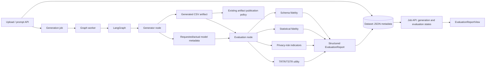

# SynthGen evaluation architecture

## Flow

## State boundaries

- **Generation state** is still the job status and artifact path. A completed job means generation produced and published an artifact under existing product policy.
- **Evaluation state** is stored in the report as `PENDING`, `RUNNING`, `COMPLETED`, `FAILED`, `INCOMPLETE`, or legacy `UNKNOWN`. A report without a successful evaluation cannot imply quality acceptance.
- **Quality acceptance** is a separate nullable field. It remains `null` because the repository has not defined a defensible use-case-specific policy for combining the metric dimensions.

An evaluator exception is caught at the graph boundary and produces a `FAILED` report with the component and safe exception summary. A component that returns unavailable metrics makes the overall evaluation `INCOMPLETE`; its own details preserve metric-level reasons. The router does not optimize from a failed, incomplete, or undecided result.

## Component modules

| Concern | Module | Contract |
|---|---|---|
| Structural schema | `backend/app/tools/schema_evaluator.py` | Status, validity, issue list, dimensions, per-column type/nullability checks |
| Statistical fidelity | `backend/app/tools/statistical_evaluator.py` | No aggregate score; per-column metrics, relationship comparisons, config and limitations |
| Privacy risk | `backend/app/tools/privacy_checker.py` | Exact match multiplicities and sampled raw mixed-type distances; no risk threshold or privacy score |
| ML utility | `backend/app/tools/ml_utility_evaluator.py` | Explicit task; same real holdout for TRTR/TSTR; raw metrics and unsupported reasons |
| Orchestration/report | `backend/app/graph/nodes.py`, `backend/app/schemas/evaluation.py` | Independent component results, execution metadata, explicit evaluation state |
| Benchmark | `backend/scripts/run_evaluation_benchmarks.py` | One requested model per run record; failed runs are not relabeled as another model |

## Data and API compatibility

The report is persisted in the existing `jobs.evaluation_report_json` JSON field; no database column migration is required. New job API responses add `generation_status`, `artifact_available`, `evaluation_status`, and `quality_accepted`. Existing `status` remains the generation status for older clients.

New reports retain legacy scalar fields (`statistical_score`, `privacy_score`, `ml_utility_score`, `overall_score`, and `passed`) as optional nullable fields so old frontend/client parsing does not fail. New reports do not calculate these scores. Historical reports with scalar fields but no `evaluation_status` are exposed by the API as `UNKNOWN`, and their prior `passed` value is not promoted to a current quality decision.

Evaluation target/task are stored under `datasets.schema_json.evaluation_config`. This reuses an existing JSON field and requires no schema migration. Older datasets without that key receive an incomplete ML utility component until the user configures the task. Upload and prompt-generation APIs accept optional `evaluation_target` and `evaluation_task` values.

## Operational boundaries

The generation worker still enforces its outer workflow timeout. Privacy evaluation uses deterministic row sampling and chunked computation; schema/statistical comparisons operate over the input table; ML utility uses the real/synthetic row limits already enforced by the application. Per-metric cancellation, resource quotas, and hardware-memory measurement are not currently implemented. Benchmark runtime is recorded; memory usage is reported as unmeasured unless a future environment adds a supported resource sampler.

No repository CI workflow was present in the inspected setup. A CI job was not added because the current backend test imports span the full application dependency graph, including the platform-sensitive SDV/PyTorch stack; that dependency installation and runtime must be made reliable before a CI result would be meaningful. Backend and frontend commands are listed in the methodology document.
