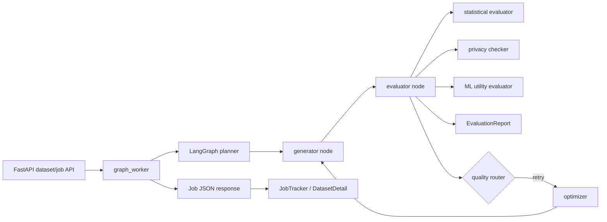

# SynthGen evaluation audit (Phase A)

**Scope:** read-only audit of the current evaluation path. No production code has been changed and no tests were run in this phase. Findings below describe inspected behavior, not benchmark results.

## Architecture traced

Relevant files inspected include `backend/app/tools/{statistical_evaluator,privacy_checker,ml_utility_evaluator,schema_validator,synthetic_generator}.py`, `backend/app/schemas/evaluation.py`, `backend/app/graph/{nodes,routers,state,workflow}.py`, `backend/app/workers/graph_worker.py`, `backend/app/api/routes/jobs.py`, evaluation and optimization agents/prompts, and frontend `JobTracker.tsx` and `DatasetDetail.tsx`. Dependency manifests and repository test files were also checked.

## Findings

### A1. Statistical metric is a lossy and partly misleading aggregate

- **Existing implementation:** `evaluate_statistical_quality` uses KS statistic for numeric columns and `1 - KS`, penalized by a relative mean difference; categorical columns use `1 - TVD`; it averages column scores into one score. It reports a KS p-value only implicitly by discarding it.
- **Problem:** relative mean difference divides by `abs(real_mean) + 1e-9`, which is unstable around zero and scale-dependent. The KS test assumes continuous samples; ties/discrete values undermine its usual interpretation. Its p-value is not a similarity score and depends heavily on sample size. A score averaging these unlike quantities treats columns equally and hides metric-specific behavior.
- **Why/consequences:** consumers can read the aggregate as calibrated fidelity or a probability of similarity, neither of which it is. Small changes can produce large or incomparable score changes.
- **Correction:** report raw per-column statistics separately (distribution distance, moments/quantiles, missingness); document direction and range. Avoid a composite unless all components have defensible normalization and explicit weights. Clarify p-value as a test result, not evidence of equivalence.
- **How to test:** deterministic numerical fixtures, zero-mean and constant columns, discrete numeric values, different sample sizes; assert raw metric ranges and that p-values are not used as scores.

### A2. Incompatible and missing columns are silently ignored

- **Existing implementation:** statistical evaluation loops over real columns and skips missing synthetic columns. It does not report extra synthetic columns, duplicate labels, type incompatibility, or schema mismatch. Empty non-null samples are also skipped.
- **Problem:** an incomplete or incompatible dataset can receive an apparently valid score based only on a subset. An all-null column vanishes from scoring.
- **Why/consequences:** errors in generation/schema preservation are hidden; evaluation coverage is unknowable.
- **Correction:** add a schema result that enumerates missing/extra/duplicate columns, type compatibility, nullability and missing-value rates. Mark affected metrics unavailable with reasons; do not silently omit them.
- **How to test:** missing/extra columns, duplicate labels, all-null/partially-null columns, incompatible numeric/category types, and empty frames.

### A3. Statistical category handling is narrower than the intended data model

- **Existing implementation:** non-numeric columns are categorized by `value_counts`; nulls are dropped before distribution comparison. Unseen categories are implicitly included in TVD through index union, but never identified explicitly.
- **Problem:** missing-value behavior is excluded; mixed or unhashable objects may fail, and categories whose representations differ by type may be conflated or mishandled. No unseen-category count is given.
- **Why/consequences:** key fidelity regressions are obscured and exceptions lack useful diagnostics.
- **Correction:** compare explicit category distributions with a stable typed representation, include missingness as a category/dimension, report unseen values, and surface incompatible values as evaluation errors/unavailable metrics.
- **How to test:** null distribution shifts, unseen categories, integer/string mixtures, high cardinality, and empty categorical columns.

### A4. Privacy exact matching is row-multiplicity biased and column-order unstable

- **Existing implementation:** `evaluate_privacy_risk` derives `common_cols` using `list(set(...))`, drops any row with any null, and inner-merges synthetic and real rows. It divides merged-row count by filtered synthetic row count.
- **Problem:** set ordering is not deterministic. SQL-style merge multiplies matches when either side has duplicate records, so `exact_matches` can exceed the number of synthetic records and the “ratio” can exceed 1. Dropping rows excludes records with missing values from disclosure checks. The output does not distinguish synthetic rows matching any real row from multiplicity of matching pairs.
- **Why/consequences:** privacy risk can be overstated, nonsensical, or vary with process/hash order; null-containing exact copies are missed.
- **Correction:** use stable schema-ordered columns and canonical row keys with explicit null/type handling. Count synthetic records with at least one real match, total matching pairs, and unique records separately.
- **How to test:** duplicate real and synthetic rows, null-containing duplicates, reordered columns, empty data, and verify ratio bounded in [0,1].

### A5. Nearest-neighbor privacy check is numeric-only and arbitrary-thresholded

- **Existing implementation:** scales numeric common columns with `StandardScaler`, samples up to 1,000 rows without a fixed random state, then checks distance `< 0.01`. Catches every exception and silently retains a default risk score. Privacy score averages exact-match complement and a “DCR score.”
- **Problem:** all categoricals and mixed-type relationships are excluded; rows with nulls were already dropped. Scaling uses synthetic sample transform but real sample determines scale, and numerical feature magnitudes/constant columns can be problematic. `0.01` has no domain justification. Sampling varies between runs. Failure looks like a neutral/no-risk outcome.
- **Why/consequences:** scores are not reproducible or comparable across datasets; risk can be missed, and the score looks more formal than the evidence supports.
- **Correction:** mixed-type preprocessing with documented distance components and schema checks; fixed-seed configurable sampling; report raw nearest-neighbor distance distributions and reference/baseline comparisons. No universal cutoff or opaque “privacy score”; represent failure explicitly.
- **How to test:** mixed/numeric/categorical data, constants, missing values, deterministic sampled indices, scaling edge cases, very large inputs, and injected estimator failure.

### A6. Membership and attribute disclosure are not measured

- **Existing implementation:** only exact matching and numeric nearest-neighbor distances are computed. There is no held-out/non-member reference group, membership attack, or quasi-identifier/sensitive-attribute analysis.
- **Problem:** current “privacy preservation” language may imply broader privacy evidence than these checks provide.
- **Why/consequences:** users may interpret absence of detected exact duplicates as anonymity or inferential safety.
- **Correction:** clearly limit claims to measured empirical indicators. Implement membership risk only with an explicit member/non-member baseline. Implement attribute disclosure only when sensitive columns and quasi-identifiers are configured and a defensible attack protocol exists. No differential-privacy claim absent a formal DP mechanism.
- **How to test:** ensure report labels and limitations are present; test baseline construction and avoid calculating attack metrics when class/reference groups are inadequate.

### A7. ML target and feature selection is nondeterministic

- **Existing implementation:** `evaluate_ml_utility` obtains common columns via set intersection, takes `common_cols[-1]` as target, and uses preceding columns as features.
- **Problem:** Python set order is not a semantic target rule and may change. The selected target may be an identifier, feature, or unusable column. There is no caller configuration or ambiguity report.
- **Why/consequences:** reported utility can describe a different prediction task across runs and is not interview/research reproducible.
- **Correction:** require explicit target configuration, or provide documented candidate detection and return an incomplete/ambiguous result until a caller resolves it. Preserve source column order.
- **How to test:** reordered columns, multiple plausible targets, invalid/missing target, and deterministic task specification.

### A8. Classification/regression detection is incorrect for many valid targets

- **Existing implementation:** classifies a numeric target when it has fewer than 10 unique values; otherwise regression. It does not test integer semantics, declared schema, cardinality relative to rows, or target meaning.
- **Problem:** low-cardinality numeric regression can become classification, and classification with 10+ classes can become regression.
- **Why/consequences:** model and metrics may be mathematically inappropriate while appearing successful.
- **Correction:** use explicit task type/schema configuration; if inferred, document and expose candidates/confidence and reject ambiguity.
- **How to test:** numeric binary/multiclass labels, integer-valued continuous targets, small-cardinality regression, and high-cardinality classification.

### A9. Label encoding leaks vocabulary and mishandles mixed/missing values

- **Existing implementation:** categorical columns are encoded after concatenating real and synthetic values, using a shared `LabelEncoder` fitted on both datasets; both frames are `dropna()`-filtered. The code labels all nonnumeric columns but has no robust preprocessing pipeline.
- **Problem:** fitting the vocabulary on synthetic data lets synthetic categories influence the real preprocessing; unseen synthetic categories should be handled explicitly. String conversion can collapse distinct typed values (for example integer `1` and string `"1"`). Row-wise dropping can discard substantial data.
- **Why/consequences:** test protocol is not cleanly separated; model failures become likely for sparse/missing inputs; results conceal missingness behavior.
- **Correction:** fit imputers/encoders on the relevant training partition only, with explicit unknown-category handling. Use separate train-fitted preprocessing for TRTR/TSTR; handle missing values explicitly. Use deterministic task-aware models and report unsupported classes/metrics.
- **How to test:** unseen categories, mixed typed categories, nulls, all-null features, and verify test split is never used to fit preprocessing.

### A10. ML utility returns success-like fallback scores and hides limitations

- **Existing implementation:** fewer than two columns returns score 1.0; fewer than 50 rows returns 0.5; exceptions return 0.5. F1 or clipped R² ratios are clamped to [0,1].
- **Problem:** unavailable or failed evaluation is represented as a numeric success/neutral value. Clipping negative R² erases evidence of worse-than-mean predictions, and ratio to a near-zero/negative reference is misleading. Classification omits requested metrics and confusion matrix; regression omits MAE/RMSE.
- **Why/consequences:** composite evaluation can pass despite failed utility measurement; scores are not comparable and can hide poor results.
- **Correction:** return explicit status, availability and reason; report TRTR and TSTR metrics side by side without clipping. Include standard task metrics and unsupported reasons. Do not force a ratio into [0,1].
- **How to test:** small data, constant targets, single-class and imbalanced targets, exception injection, negative/zero TRTR R², and raw metric calculations.

### A11. Evaluation errors can be turned into successful generation

- **Existing implementation:** `evaluate_data_node` catches broad exceptions, sets `is_successful=True`, and says generated data will be used. The worker later treats any existing synthetic path as success when `is_successful` is false. It can mark the job `COMPLETED` without an evaluation report.
- **Problem:** generation success, evaluation success, and quality acceptance are conflated. The graph router then ends after an evaluation exception, and worker fallback makes unevaluated output look completed.
- **Why/consequences:** API/frontend “completed” status is not evidence the evaluation ran; failed evaluations may be stored/downloadable without explicit state.
- **Correction:** model generation and evaluation states separately. Evaluation exception should create `FAILED`/`INCOMPLETE` report and must not set evaluation success. Preserve generated artifact only under an explicit product policy, with report clearly indicating evaluation failure; never claim quality pass.
- **How to test:** injected evaluator exception end-to-end; verify state, job status/report, API response, and frontend display distinguish generation artifact availability from evaluation result.

### A12. Composite score and pass thresholds are arbitrary and opaque

- **Existing implementation:** graph node combines statistical 0.4, privacy 0.4, and ML 0.2, then compares to `QUALITY_THRESHOLD`; a privacy floor is `max(0.5, quality_threshold - 0.15)`. Schema fidelity is absent.
- **Problem:** component scores have incompatible meanings and misleading scales; ML fallback scores participate as normal numbers. Thresholds are not tied to a documented acceptance use case or calibration.
- **Why/consequences:** overall pass can mask a serious weakness; optimizations target arbitrary score movements.
- **Correction:** report four separate dimensions (statistical, privacy indicators, utility, schema). Prefer no overall score. If retained, define normalization and weights, expose every component and failure, and calibrate thresholds to explicit application requirements.
- **How to test:** report schema validation; missing component must prevent pass; test component behavior independently and pass/fail traceability.

### A13. API schema is too narrow and frontend fabricates display values

- **Existing implementation:** `EvaluationReport` has only five scalar fields plus detail dictionaries and no status, schema result, metric availability, configuration, or errors. Job endpoints return the stored JSON without a response model. `JobTracker` displays `score || default`, replacing valid zero with invented values (0.9/0.99/0.85); `DatasetDetail` shows percentages for all dimensions.
- **Problem:** contract cannot express incomplete/failed metrics; defaults misrepresent missing and zero results. Existing frontend interprets privacy as a “preservation” percentage.
- **Why/consequences:** reported UI values can differ from persisted evaluation; users cannot distinguish unavailable from zero or failure.
- **Correction:** evolve Pydantic/API contract with explicit evaluation status, component status, raw metrics, reasons and schema dimension. Confirm contract before frontend changes; render unavailable/error states without fabricated values and label privacy measurements as risk indicators.
- **How to test:** API response validation plus frontend fixtures for absent, zero, failed and incomplete metrics.

### A14. Optimization loop consumes an opaque aggregate

- **Existing implementation:** `should_optimize` routes based on `is_successful`, and optimization agent receives full report JSON. Generator node overrides CTGAN/TVAE with GaussianCopula unless `ALLOW_SLOW_MODELS=true`; unknown model names also fall back to GaussianCopula. The actual selected model is not clearly recorded as the executed model in the evaluation report.
- **Problem:** optimization may act on noisy/arbitrary weighted scores; model comparisons may be falsely attributed to CTGAN/TVAE if override/fallback is not surfaced in output.
- **Why/consequences:** generated benchmark claims and optimization rationale may identify a model that did not execute.
- **Correction:** record requested and actual model, fallback reason and effective parameters in job/report metadata. Route based on explicit evaluation state and dimension-specific criteria.
- **How to test:** override/fallback paths, serialized metadata, and router behavior for failed/incomplete reports.

### A15. Resource limits and deterministic configuration are incomplete

- **Existing implementation:** privacy samples up to 1,000 rows without `random_state`; statistical evaluation scans full columns; ML trains two random forests with fixed seed but unbounded input size and fixed implicit preprocessing/model defaults. Worker has a 900-second overall workflow timeout.
- **Problem:** privacy results vary; runtime/memory are not represented in the report. Broad evaluator failures are swallowed in privacy and ML code. Existing timeout wraps the workflow, not each metric with a useful per-metric state.
- **Why/consequences:** hard-to-reproduce results and poor diagnosis of resource-driven missing metrics.
- **Correction:** configure seeds, explicit sample sizes/strategy, task/model settings and limits; record configuration/runtime/environment and report timeout/error per metric. Preserve dimensions as unavailable rather than dropping them.
- **How to test:** fixed-seed repeated evaluation, large synthetic fixtures with configured caps, timing metadata presence, and injected timeout/error reporting.

### A16. Test and CI coverage is insufficient for evaluation claims

- **Existing implementation:** repository discovery found only root `test_loader.py` and `test_schema.py`; no `backend/tests` suite or pytest/CI workflow was found in the inspected file list. Dependency manifests include pytest in `requirements-dev.txt`.
- **Problem:** evaluator edge cases, failure paths, determinism, API contracts and graph/worker status transitions lack visible automated coverage.
- **Why/consequences:** changes to critical evaluation behavior can regress silently; no measured test results support reliability claims.
- **Correction:** add small deterministic fixtures and unit/integration tests across evaluator and workflow edge cases, then add CI only if the repository’s CI environment is established.
- **How to test:** run focused pytest suite and full configured suite; report actual command output and avoid unmeasured coverage claims.

## Dependency and compatibility observations

- Backend manifests include pandas, NumPy, SciPy, scikit-learn, SDV, FastAPI and Pydantic 2; current evaluator imports are mostly local to function calls.
- `EvaluationReport` is a Pydantic 2 model (`model_dump()` is used in graph nodes), so future schema changes must preserve the current API’s stored-JSON compatibility or be versioned/migrated.
- The generation/worker path stores evaluation report JSON in the existing job JSON column. Job status remains generation-oriented, so an evaluation status field is needed to represent successful generation with incomplete/failed evaluation accurately.
- Frontend components currently use loose `any`/partial interfaces, so backend contract must be settled before UI presentation changes.

## Phase A conclusion

The inspected code confirms substantial correctness and reporting issues in all three evaluators and the evaluation-to-job success path. The largest immediate risk is not a subtle metric nuance: evaluator exceptions and unavailable utility can be converted into success-like states, while the UI may display fabricated default scores. Column/target set ordering, duplicate merge multiplicity, dropped null rows, arbitrary privacy thresholds, and unsupported task inference also make metrics unstable or hard to interpret.

This document is the complete Phase A deliverable. No benchmark values were generated. No tests were run. Production code remains unchanged.
